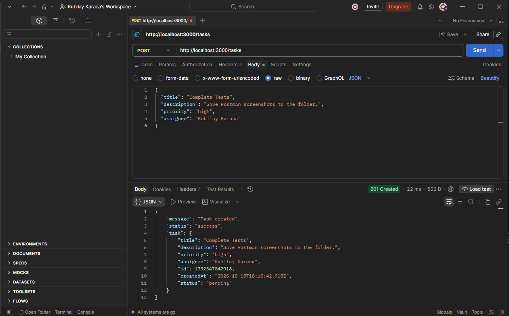
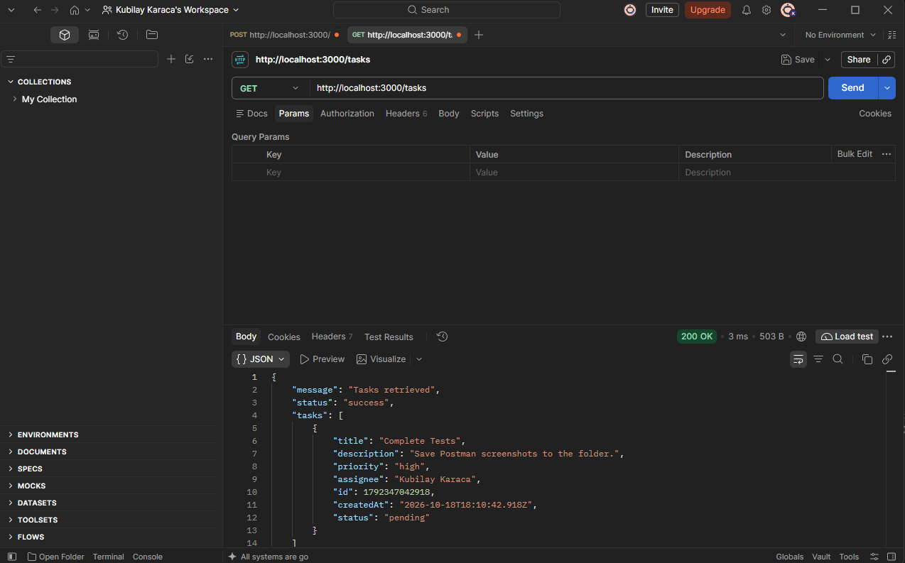
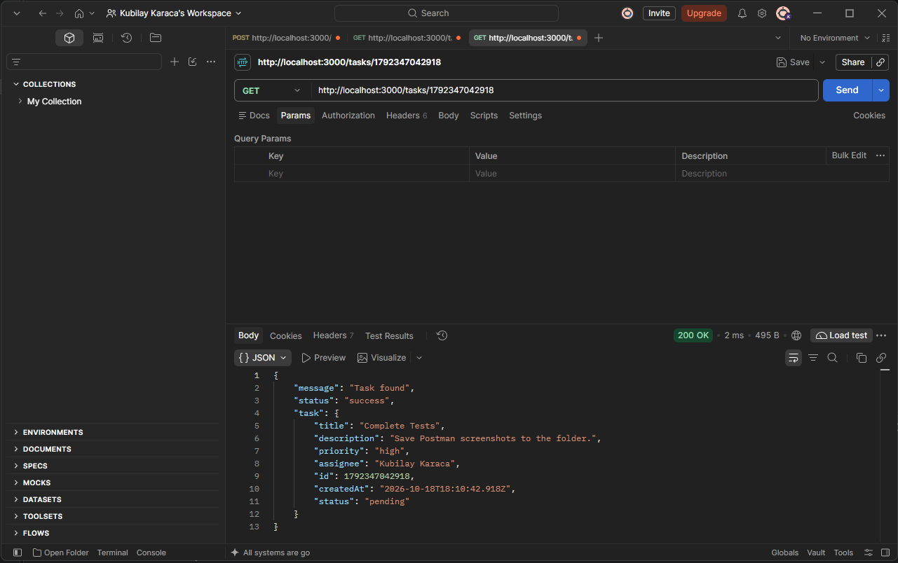
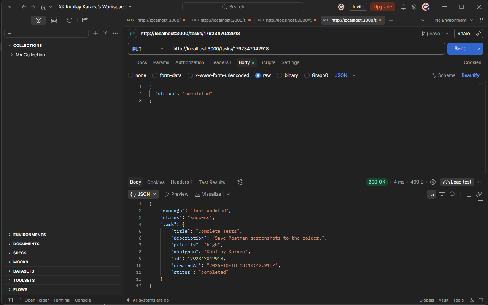
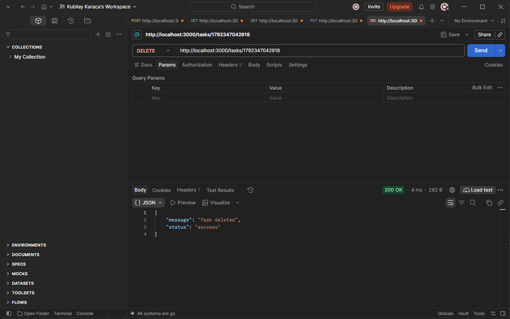
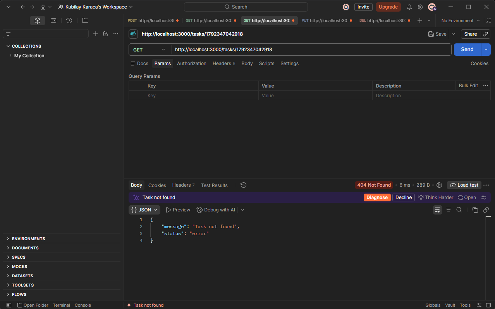

# 📝 Task Manager API


Node.js ve Express.js üzerine inşa edilmiş, kalıcı veri depolama için dosya sistemini (JSON) kullanan hafif, hızlı ve bağımsız bir RESTful Görev Yönetimi API'si.

Bu proje, veritabanı bağımlılığı olmadan tam kapsamlı CRUD operasyonlarını, gelişmiş hata yönetimini ve dinamik yönlendirme mimarisini uçtan uca sunar.

> 📄 Projenin amacı, senaryosu, veri modeli ve endpoint listesi için: **[Proje Tanıtım Dokümanı](PROJE_TANITIM.md)**

---

## 📑 İçindekiler
- [Özellikler](#-özellikler)
- [Mimari ve Teknolojiler](#-mimari-ve-teknolojiler)
- [Klasör Yapısı](#-klasör-yapısı)
- [Kurulum Rehberi](#-kurulum-rehberi)
- [API Dokümantasyonu](#-api-dokümantasyonu)
- [Hata Yönetimi ve Durum Kodları](#-hata-yönetimi-ve-durum-kodları)
- [Test ve Doğrulama](#-test-ve-doğrulama)
- [Postman Test Ekran Görüntüleri](#postman-test-ekran-görüntüleri)

---

## 🚀 Özellikler
- **Tam CRUD Desteği:** Görevleri oluşturma, okuma, güncelleme ve kalıcı olarak silme.
- **Kalıcı Depolama:** Veriler anlık olarak `fs` modülü ile fiziksel `tasks.json` dosyasına işlenir.
- **Parametrik Yönlendirme:** Benzersiz ID'ler üzerinden tekil veri manipülasyonu.
- **İstek Kaydı (Logger Middleware):** Gelen her isteğin zaman damgası, HTTP metodu ve uç noktası konsola yazdırılır.
- **Güvenli Hata Yakalama:** Merkezi hata yönetimi, 400, 404 ve 500 hataları için yapılandırılmış JSON dönüşleri.
- **Temel Kontrol:** Başlığı (`title`) olmayan veya bozuk JSON içeren istekler `400 Bad Request` ile reddedilir; görev `id` ve `createdAt` alanları güncellemeyle değiştirilemez.
- **Hafif ve Bağımsız:** Harici bir veritabanı kurulumu (MongoDB, SQL vb.) gerektirmez.

---

## 🛠 Mimari ve Teknolojiler
- **Çalışma Ortamı:** [Node.js](https://nodejs.org/)
- **Web Çerçevesi:** [Express.js](https://expressjs.com/)
- **Veri Katmanı:** Node.js Native `fs` (File System) & JSON
- **Test Aracı:** Postman

---

## 📁 Klasör Yapısı
Proje, sürdürülebilirlik ve ölçeklenebilirlik prensiplerine uygun olarak modüler bir yapıda tasarlanmıştır:

```text
task-manager-api/
├── data/
│   └── tasks.json         # Fiziksel veri depolama dosyası
├── screenshots/           # Postman test ekran görüntüleri
├── src/
│   ├── app.js             # Express uygulama yapılandırması ve sunucu girişi
│   ├── middleware/
│   │   └── logger.js      # İstek kayıt (logger) middleware'i
│   ├── routes/
│   │   └── tasks.js       # Görev yönetimi uç noktaları (Router)
│   └── utils/
│       └── file.js        # JSON dosyası okuma, yazma ve yedekleme
├── .env                   # Çevresel değişkenler (repoya eklenmez)
├── package.json           # Bağımlılık ağacı ve NPM scriptleri
├── PROJE_TANITIM.md       # Proje tanıtım dokümanı
└── README.md              # Proje dokümantasyonu
```

---

## ⚙️ Kurulum Rehberi

Geliştirme ortamınızı kurmak için aşağıdaki adımları sırasıyla uygulayın.

### Ön Koşullar
- Node.js (v18.x veya üzeri)
- NPM veya Yarn paket yöneticisi

### Adımlar

1. **Projeyi İndirin:**
   ```bash
   git clone https://github.com/KubilayKaraca/task-manager-api.git
   cd task-manager-api
   ```

2. **Bağımlılıkları Yükleyin:**
   Proje kök dizininde terminalinizi açın ve gerekli paketleri indirin.
   ```bash
   npm install
   ```

3. **Çevresel Değişkenleri Ayarlayın (Opsiyonel):**
   Ana dizinde bir `.env` dosyası oluşturun. Oluşturulmazsa sunucu varsayılan olarak 3000 portunda çalışır.
   ```env
   PORT=3000
   ```

4. **Sunucuyu Başlatın:**
   ```bash
   npm start
   ```
   veya
   ```bash
   node src/app.js
   ```
   > Başarılı başlatma sonrasında terminalde `Server is running on port 3000` çıktısı alınacaktır.

5. **İstek Kayıtlarını (Logger) İzleyin:**
   Sunucuya gelen her istek, Logger middleware'i tarafından terminale şu biçimde yazdırılır:
   ```text
   2026-10-18T18:10:42.918Z - POST /tasks
   2026-10-18T18:11:05.120Z - GET /tasks/1792347042918
   ```

---

## 📡 API Dokümantasyonu

Temel URL: `http://localhost:3000/tasks`

### 1. Tüm Görevleri Getir
Sistemde kayıtlı olan tüm görevleri liste formatında döndürür.
- **Metot:** `GET`
- **Uç Nokta:** `/`
- **Başarılı Yanıt (200 OK):**
  ```json
  {
    "message": "Tasks retrieved",
    "status": "success",
    "tasks": [ ... ]
  }
  ```

### 2. Tekil Görev Getir
Benzersiz ID numarasına göre spesifik bir görevi döndürür.
- **Metot:** `GET`
- **Uç Nokta:** `/:id`
- **Başarılı Yanıt (200 OK):**
  ```json
  {
    "message": "Task found",
    "status": "success",
    "task": {
      "id": 1792347042918,
      "title": "Complete Tests",
      "description": "Save Postman screenshots to the folder.",
      "priority": "high",
      "assignee": "Kubilay Karaca",
      "createdAt": "2026-10-18T18:10:42.918Z",
      "status": "pending"
    }
  }
  ```

### 3. Yeni Görev Oluştur
Sisteme yeni bir görev kaydeder. Sistem ID, oluşturulma tarihi ve başlangıç durumunu (pending) otomatik atar.
- **Metot:** `POST`
- **Uç Nokta:** `/`
- **İstek Gövdesi (JSON):**
  ```json
  {
    "title": "Update README File",
    "description": "Write detailed setup instructions.",
    "priority": "medium",
    "assignee": "Kubilay Karaca"
  }
  ```
- **Başarılı Yanıt (201 Created):** `{"message": "Task created", "status": "success", "task": { ... }}`

### 4. Görev Güncelle
Mevcut bir görevin statüsünü veya diğer bilgilerini günceller.
- **Metot:** `PUT`
- **Uç Nokta:** `/:id`
- **İstek Gövdesi (JSON):**
  ```json
  {
    "status": "completed"
  }
  ```
- **Başarılı Yanıt (200 OK):** `{"message": "Task updated", "status": "success", "task": { ... }}`

### 5. Görev Sil
Görev verisini sistemden kalıcı olarak temizler.
- **Metot:** `DELETE`
- **Uç Nokta:** `/:id`
- **Başarılı Yanıt (200 OK):**
  ```json
  {
    "message": "Task deleted",
    "status": "success"
  }
  ```

---

## 🛡 Hata Yönetimi ve Durum Kodları

API, istemci ve sunucu hatalarında standartlaştırılmış HTTP durum kodları ve JSON hata mesajları döndürür.

| Kod | Durum | Açıklama |
| :--- | :--- | :--- |
| **200** | `OK` | İstek başarıyla işlendi (GET, PUT, DELETE). |
| **201** | `Created` | Yeni kaynak başarıyla oluşturuldu (POST). |
| **400** | `Bad Request` | Görev başlığı (`title`) eksik/boş veya istek gövdesi bozuk JSON. |
| **404** | `Not Found` | İstenen uç nokta veya belirtilen ID'ye sahip görev bulunamadı. |
| **500** | `Internal Error` | Sunucu tarafında veri okuma/yazma işlemi sırasında beklenmeyen bir hata oluştu. |

---

## 🧪 Test ve Doğrulama

Bu API uç noktalarının tamamı (GET, POST, PUT, DELETE) **Postman** kullanılarak uçtan uca test edilmiş ve tam kararlılıkla çalıştığı doğrulanmıştır. 
Özellikle silme (DELETE) işleminin bütünlüğü, silinen veriye tekrar erişilmeye çalışıldığında (GET `/:id`) başarılı bir şekilde `404 Not Found` hatası alınmasıyla güvence altına alınmıştır.

### Postman Test Ekran Görüntüleri

| İşlem | Ekran Görüntüsü |
| :--- | :--- |
| Görev ekleme (`POST /tasks` → 201) |  |
| Görev listeleme (`GET /tasks` → 200) |  |
| Görev detayı (`GET /tasks/:id` → 200) |  |
| Görev güncelleme (`PUT /tasks/:id` → 200) |  |
| Görev silme (`DELETE /tasks/:id` → 200) |  |
| Silinen göreve erişim (`GET /tasks/:id` → 404) |  |
